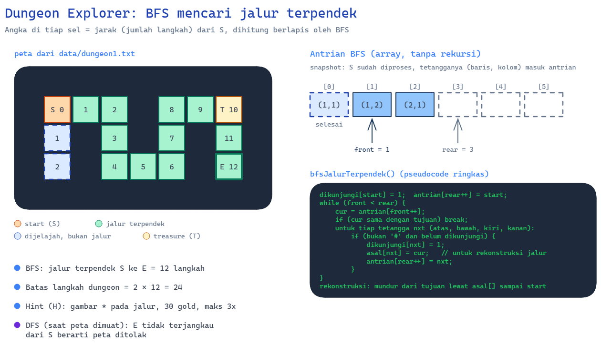
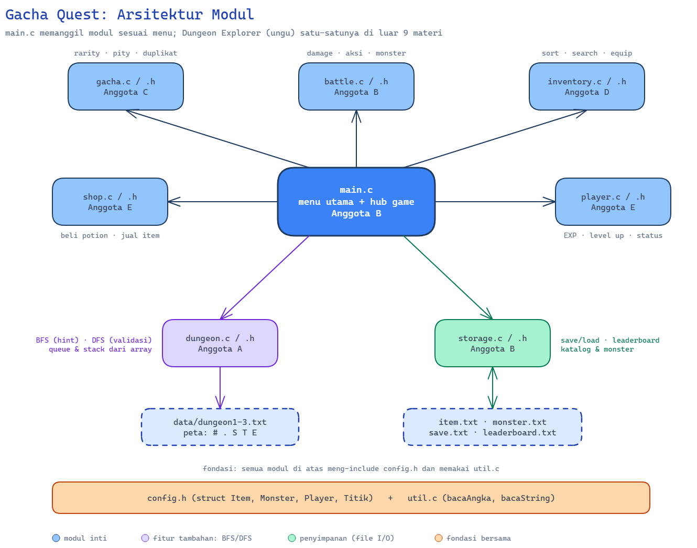
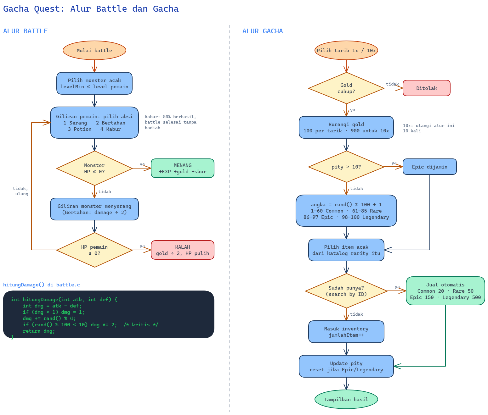

# Projek UAS Daspro | Gacha Quest

# PRD: Gacha Quest

*Mini RPG + Gacha berbasis CLI (Bahasa C) · Proyek UAS Dasar Pemrograman · Kelompok 5 orang · v1.0 · 13 November 2026*

## 1. Ringkasan

**Gacha Quest** adalah game teks (CLI) berbahasa C. Pemain bertarung melawan monster untuk mendapat *gold* dan EXP, memakai gold untuk **gacha** (senjata dan armor acak dengan sistem rarity dan pity), lalu memakai perlengkapan itu untuk melawan monster yang lebih kuat. Ada satu fitur tambahan, **Dungeon Explorer**, berupa peta grid dari file yang dijelajahi pemain dengan bantuan **BFS** (hint jalur terpendek) dan **DFS** (validasi peta).

Tujuan utama proyek bukan kecanggihan game, tetapi **pemakaian 9 materi kuliah secara lengkap, rapi, dan tanpa crash**, serta bisa dijelaskan oleh seluruh anggota kelompok.

## 2. Tujuan dan Non-Tujuan

**Tujuan**

- Seluruh 9 materi kuliah terpakai secara nyata di dalam program.
- Program stabil: input salah atau file rusak tidak membuat program crash.
- Kode modular (beberapa file .c dan .h), mudah dibagi ke 5 orang.
- Alur demo jelas untuk presentasi: *new game → battle → gacha → equip → dungeon → save → load → leaderboard*.

**Non-Tujuan (sengaja tidak dikerjakan)**

- Grafik, suara, atau library eksternal (hanya CLI).
- Multiplayer, jaringan, atau database.
- Generate maze otomatis dan editor peta.
- Linked list, alokasi memori dinamis (malloc), dan struct bersarang yang kompleks.
- Fitur di luar daftar pada bagian 5. Fitur bonus baru boleh dikerjakan setelah semua fitur wajib selesai dan lolos pengujian.

## 3. Batasan Teknis

| Aspek | Ketentuan |
| --- | --- |
| Bahasa dan standar | C (gcc -std=c99 -Wall -Wextra), tanpa warning |
| Library | stdio.h, stdlib.h, string.h, time.h, ctype.h |
| Materi yang dipakai | Hanya 9 materi yang sudah dipelajari. **Pengecualian:** Dungeon Explorer (BFS/DFS) |
| Penyimpanan data | Array dan struct berukuran tetap (konstanta di config.h) |
| Variabel global | Dihindari; data dikirim lewat parameter (pointer) |
| Rekursi | Tidak dipakai. BFS memakai *queue* dari array (front, rear), DFS memakai *stack* dari array |
| Platform | Terminal (Windows, Linux, atau WSL), teks ASCII |

## 4. Pengguna dan Skenario

Pengguna adalah mahasiswa atau dosen penguji yang menjalankan program di terminal.

1. Pemain memilih **Game Baru**, memasukkan nama, lalu mendapat 200 gold awal.
2. Pemain melakukan beberapa **Battle** untuk mengumpulkan gold dan EXP.
3. Pemain melakukan **Gacha**, mendapat item, lalu **Equip** item tersebut.
4. Pemain mencoba **Dungeon Explorer**, memakai Hint BFS bila buntu.
5. Pemain **Simpan** progres, keluar, lalu **Lanjutkan** dari file.
6. Skor akhir masuk ke **Leaderboard**.

## 5. Daftar Fitur

| ID | Fitur | Deskripsi singkat | Prioritas |
| --- | --- | --- | --- |
| F-01 | Menu utama | Game baru, lanjutkan, leaderboard, keluar | Wajib |
| F-02 | Hub game | Battle, gacha, inventory, shop, dungeon, status, simpan, kembali | Wajib |
| F-03 | Battle | Pertarungan bergiliran melawan monster acak | Wajib |
| F-04 | Gacha | Tarik 1x atau 10x, rarity, pity, duplikat jadi gold | Wajib |
| F-05 | Inventory | Lihat, urutkan, cari, dan equip item | Wajib |
| F-06 | Shop | Beli potion, jual item | Wajib |
| F-07 | Level dan status | EXP, naik level, statistik pemain | Wajib |
| F-08 | Simpan dan muat | Progres disimpan ke file dan bisa dimuat kembali | Wajib |
| F-09 | Leaderboard | Skor disimpan ke file, diurutkan, ditampilkan top 5 | Wajib |
| F-10 | Dungeon Explorer | Peta dari file, gerak WASD, Hint BFS, validasi DFS | Wajib (fitur tambahan) |

### 5.1 Alur Menu

**Menu utama:** 1 Game Baru · 2 Lanjutkan · 3 Leaderboard · 0 Keluar.

**Hub game:** 1 Battle · 2 Gacha · 3 Inventory · 4 Shop · 5 Dungeon · 6 Status · 7 Simpan · 0 Kembali ke menu utama (menawarkan simpan dan mencatat skor ke leaderboard).

## 6. Aturan Game

### 6.1 Statistik awal dan level

- Pemain awal: HP 100, ATK 10, DEF 3, gold 200, potion 2, level 1.
- EXP yang dibutuhkan untuk naik level: level × 50. Level maksimum 10.
- Naik level: maxHp +15, ATK +2, DEF +1, HP dipulihkan penuh.
- ATK total = ATK dasar + power senjata terpasang. DEF total = DEF dasar + power armor terpasang.

### 6.2 Battle

Monster dipilih acak dari monster yang levelMin-nya kurang dari atau sama dengan level pemain. Pemain bertindak lebih dulu, lalu monster.

| Aksi | Efek |
| --- | --- |
| 1. Serang | Memberi damage ke monster |
| 2. Bertahan | Damage yang diterima pada giliran itu dibagi 2 (minimal 1) |
| 3. Potion | Pulihkan 50 HP (maksimal maxHp), stok potion berkurang 1 |
| 4. Kabur | 50% berhasil (battle selesai tanpa hadiah); gagal berarti monster menyerang |
- **Damage:** max(1, ATK − DEF_lawan) + (rand() % 4). Peluang kritis 10% (damage × 2).
- **Menang:** pemain mendapat EXP dan gold monster, skor bertambah sebesar EXP monster.
- **Kalah:** gold berkurang setengah, HP dipulihkan penuh, tidak ada game over.

**Tabel monster** (disimpan di data/monster.txt):

| ID | Nama | HP | ATK | DEF | EXP | Gold | Level min |
| --- | --- | --- | --- | --- | --- | --- | --- |
| 1 | Slime | 30 | 6 | 0 | 10 | 15 | 1 |
| 2 | Goblin | 45 | 8 | 2 | 15 | 25 | 1 |
| 3 | Serigala | 60 | 11 | 3 | 22 | 35 | 2 |
| 4 | Skeleton | 80 | 14 | 5 | 30 | 50 | 3 |
| 5 | Orc | 110 | 18 | 8 | 45 | 75 | 4 |
| 6 | Troll | 150 | 22 | 10 | 65 | 110 | 5 |
| 7 | Naga (Boss) | 250 | 30 | 14 | 150 | 300 | 7 |

Angka di atas adalah nilai awal; boleh disesuaikan saat pengujian keseimbangan game.

### 6.3 Gacha

- Biaya: 100 gold per tarikan, paket 10x seharga 900 gold.
- Rarity ditentukan dari rand() % 100 + 1: **Common** 1-60, **Rare** 61-85, **Epic** 86-97, **Legendary** 98-100.
- **Pity:** jika 10 tarikan berturut-turut tidak menghasilkan Epic atau lebih tinggi, tarikan berikutnya dijamin Epic. Penghitung pity direset saat Epic atau Legendary didapat.
- Setelah rarity ditentukan, item dipilih acak dari item berrarity tersebut di katalog.
- **Duplikat:** jika item sudah dimiliki (dicek dengan *sequential search* berdasarkan ID), item otomatis dijual menjadi gold: Common 20, Rare 50, Epic 150, Legendary 500.

**Katalog item** (disimpan di data/item.txt; tipe S = senjata/bonus ATK, A = armor/bonus DEF):

| ID | Nama | Tipe | Rarity | Power |
| --- | --- | --- | --- | --- |
| 1 | Pedang Kayu | S | Common | 3 |
| 2 | Belati Besi | S | Common | 5 |
| 3 | Kapak Perang | S | Rare | 9 |
| 4 | Pedang Baja | S | Rare | 11 |
| 5 | Tombak Naga | S | Epic | 17 |
| 6 | Katana Bayangan | S | Epic | 19 |
| 7 | Excalibur | S | Legendary | 30 |
| 8 | Palu Dewa | S | Legendary | 28 |
| 9 | Baju Kain | A | Common | 2 |
| 10 | Rompi Kulit | A | Common | 3 |
| 11 | Zirah Besi | A | Rare | 6 |
| 12 | Perisai Baja | A | Rare | 7 |
| 13 | Zirah Naga | A | Epic | 11 |
| 14 | Jubah Penyihir | A | Epic | 10 |
| 15 | Armor Titan | A | Legendary | 18 |
| 16 | Jubah Dewa | A | Legendary | 16 |

### 6.4 Inventory

- Menampilkan semua item milik pemain dalam bentuk tabel (ID, nama, tipe, rarity, power, status terpasang).
- **Urutkan** berdasarkan rarity, power, atau nama (A-Z).
- **Cari** item berdasarkan nama (pencarian sebagian, tidak membedakan huruf besar kecil).
- **Equip:** satu slot senjata dan satu slot armor. Memasang item baru menggantikan yang lama.
- Kapasitas inventory sama dengan jumlah katalog (16), karena duplikat tidak disimpan.

### 6.5 Shop

- **Beli potion:** 40 gold per potion (maksimal stok 20).
- **Jual item:** harga sesuai rarity (lihat 6.3). Item yang sedang terpasang tidak bisa dijual.

### 6.6 Skor dan leaderboard

- Skor bertambah setiap kemenangan battle (sebesar EXP monster) dan setiap dungeon selesai (+50).
- Saat kembali ke menu utama, nama|level|skor ditambahkan ke data/leaderboard.txt. Data diurutkan menurun berdasarkan skor, dan hanya 10 teratas yang disimpan. Layar leaderboard menampilkan top 5.

## 7. Dungeon Explorer (Fitur Tambahan)

Fitur ini adalah versi ringan dari ide maze awal: **tanpa generate peta dan tanpa editor**. Peta dibuat manual oleh tim dan dibaca dari file.

- **Peta:** data/dungeon1.txt, dungeon2.txt, dungeon3.txt, disimpan di array 2D (maksimal 20 × 40). Simbol: # tembok, . jalan, S start, T treasure, E exit.
- **Gerak:** W A S D, tembok tidak bisa dilewati, langkah dihitung.
- **Treasure:** T memberi 30 gold lalu berubah menjadi ..
- **Exit:** mencapai E memberi 100 gold, 40 EXP, dan skor +50.
- **Batas langkah:** 2 × panjang jalur terpendek (BFS) dari S ke E. Jika melebihi batas, pemain keluar tanpa hadiah exit (treasure yang sudah diambil tetap dihitung).
- **BFS (hint):** tombol H menggambar jalur terpendek dari posisi pemain ke E dengan tanda *. Biaya 30 gold, maksimal 3 kali per kunjungan.
- **DFS (validasi):** saat peta dimuat, DFS memeriksa apakah E dapat dicapai dari S. Peta yang tidak valid ditolak dan tidak ditampilkan di menu.
- **Implementasi:** BFS memakai queue array (front, rear), array dikunjungi\[]\[], dan array asal\[]\[] untuk merekonstruksi jalur. DFS memakai stack array (iteratif, tanpa rekursi).

Contoh dungeon1.txt:

\#########\
#S..#..T#\
#.#.#.#.#\
#.#...#E#\
\#########

## 8. Desain Data

#define MAX_ITEM 16\
#define MAX_MONSTER 10\

typedef struct {\
int id;\
char nama\[30];\
char tipe;        /* 'S' senjata, 'A' armor \*/\
int rarity;       /* 1 Common, 2 Rare, 3 Epic, 4 Legendary \*/\
int power;\
} Item;\

typedef struct {\
int id;\
char nama\[30];\
int hp, atk, def;\
int exp, gold, levelMin;\
} Monster;\

typedef struct {\
char nama\[30];\
int hp, maxHp, atk, def;\
int level, exp, gold, potion;\
int pity, totalPull, skor;\
Item inventory\[MAX_ITEM];\
int jumlahItem;\
int idxSenjata, idxArmor;   /* -1 jika kosong */\
} Player;\

typedef struct { int baris, kolom; } Titik;

## 9. Format File

data/item.txt dan data/monster.txt (satu data per baris, dipisah tanda |):

1|Pedang Kayu|S|1|3\
7|Excalibur|S|4|30

1|Slime|30|6|0|10|15|1

data/save.txt (progres pemain; item disimpan sebagai ID saja lalu dicocokkan ke katalog):

Budi|100|100|1|0|200|10|3|2|0|0|0|-1|-1\
3\
1\
9\
3

Baris 1: nama|hp|maxHp|level|exp|gold|atk|def|potion|pity|totalPull|skor|idSenjata|idArmor. Baris 2: jumlah item. Baris berikutnya: ID item milik pemain.

data/leaderboard.txt: nama|level|skor per baris.

## 10. Arsitektur Modul

gacha-quest/\
├── main.c          menu utama dan loop game\
├── config.h        konstanta dan struct bersama\
├── player.c/.h     status, level up, tambah EXP dan gold\
├── battle.c/.h     monster, loop battle, damage\
├── gacha.c/.h      tarikan, rarity, pity, duplikat\
├── inventory.c/.h  tampil, urutkan, cari, equip\
├── shop.c/.h       beli potion, jual item\
├── storage.c/.h    muat katalog, simpan dan muat game, leaderboard\
├── dungeon.c/.h    peta, gerak, BFS, DFS\
├── util.c/.h       validasi input, bersihkan layar, garis pemisah\
└── data/           item.txt, monster.txt, save.txt, leaderboard.txt, dungeon1-3.txt

Diagram arsitektur dan alur ada pada bagian 14.

### 10.1 Kontrak fungsi (disepakati sebelum coding)

| Modul | Fungsi | Keterangan |
| --- | --- | --- |
| util | int bacaAngka(const char *prompt, int min, int max) | Baca integer dengan validasi, ulang sampai valid |
| util | void bacaString(const char *prompt, char *out, int maks) | Baca string aman |
| player | void initPlayer(Player *p, const char *nama) | Nilai awal pemain baru |
| player | void tambahExp(Player *p, int exp) | Tambah EXP dan proses naik level |
| player | int hitungAtk(const Player *p) / int hitungDef(const Player *p) | Statistik total |
| player | void tampilStatus(const Player *p) | Tampilan status |
| battle | void mulaiBattle(Player *p, const Monster m\[], int jml) | Seluruh loop battle |
| battle | int hitungDamage(int atk, int def) | Rumus damage |
| gacha | void menuGacha(Player *p, const Item katalog\[], int jml) | Menu gacha |
| gacha | int tentukanRarity(int *pity) | Rarity dari angka acak dan pity |
| gacha | int cariItemDiInventory(const Player *p, int id) | Sequential search berdasarkan ID |
| inventory | void menuInventory(Player *p) | Menu inventory |
| inventory | void urutkanInventory(Player *p, int mode) | Sort berdasarkan rarity, power, atau nama |
| inventory | int cariItemNama(const Player *p, const char *kata) | Pencarian berdasarkan nama |
| inventory | void equipItem(Player *p, int idx) | Pasang item |
| shop | void menuShop(Player *p) | Beli dan jual |
| storage | int muatKatalog(const char *file, Item k\[]) / int muatMonster(const char *file, Monster m\[]) | Baca data awal |
| storage | int simpanGame(const Player *p) / int muatGame(Player *p, const Item k\[], int jml) | Simpan dan muat progres |
| storage | void catatSkor(const Player *p) / void tampilLeaderboard(void) | Leaderboard (sorting) |
| dungeon | int muatPeta(const char *file, char peta\[]\[MAX_KOLOM], Titik *s, Titik *e) | Baca peta dari file |
| dungeon | int dfsBisaDicapai(char peta\[]\[MAX_KOLOM], Titik dari, Titik ke) | Validasi peta |
| dungeon | int bfsJalurTerpendek(char peta\[]\[MAX_KOLOM], Titik dari, Titik ke, Titik jalur\[]) | Panjang jalur (-1 jika tidak ada) |
| dungeon | void jalankanDungeon(Player *p) | Loop dungeon |

## 11. Pemetaan 9 Materi

| Materi | Wujud di program |
| --- | --- |
| 1. Input, output, variabel, tipe data | Semua menu, form nama, tabel status dan inventory (printf berformat) |
| 2. Operator, ekspresi, konversi | Rumus damage, EXP, harga, peluang rarity, konversi char ke int pada input menu |
| 3. Percabangan | switch pada semua menu, penentuan rarity, hasil battle, validasi |
| 4. Perulangan | Loop menu, loop battle, tarikan 10x, validasi input berulang |
| 5. Array dan string | Inventory, katalog, monster, nama pemain, peta 2D, strcmp dan strstr |
| 6. Pointer | Player *p pada hampir semua fungsi, int *pity, parameter keluaran (Titik *s) |
| 7. Struct | Item, Monster, Player, Titik |
| 8. Search dan sorting | Cari item (nama dan ID), urut inventory, urut leaderboard; BFS/DFS sebagai tambahan |
| 9. File I/O | Muat katalog dan monster, save dan load, leaderboard, peta dungeon |

## 12. Validasi dan Penanganan Error

- Semua input angka melewati bacaAngka (huruf, simbol, atau angka di luar rentang tidak membuat program crash).
- Input string dibatasi panjangnya agar tidak melebihi array.
- File yang tidak ditemukan atau formatnya rusak: tampilkan pesan jelas, tidak crash. save.txt yang rusak berarti opsi Lanjutkan menampilkan pesan gagal.
- Gold tidak boleh bernilai negatif; pembelian gagal bila gold kurang.
- Peta dungeon tidak valid (DFS gagal) tidak ditampilkan.
- srand(time(NULL)) dipanggil sekali di main.

## 13. Pembagian Kerja dan Rencana Pengerjaan

| Anggota | Peran | Modul |
| --- | --- | --- |
| A (berpengalaman) | Arsitek dungeon | config.h, dungeon.c/.h, data peta |
| B (berpengalaman) | Integrator | main.c, battle.c/.h, storage.c/.h |
| C (pemula) | Gacha | gacha.c/.h |
| D (pemula) | Inventory | inventory.c/.h |
| E (pemula) | Shop dan status | shop.c/.h, player.c/.h, util.c/.h |

Anggota A dan B membimbing C, D, E melalui *code review* singkat di setiap fase.

| Fase | Isi | Keluaran |
| --- | --- | --- |
| 0. Kesepakatan | Sepakati config.h (struct) dan prototipe fungsi (bagian 10.1) | Kerangka kompilasi dengan fungsi kosong |
| 1. Modul | Tiap anggota mengerjakan modulnya dan mengujinya sendiri | Modul berjalan dengan *driver* uji kecil |
| 2. Integrasi | B menggabungkan semua modul ke main.c, perbaiki bug antarmodul | Game utuh bisa dimainkan |
| 3. Pengujian | Jalankan skenario pada bagian 15, perbaiki bug, rapikan tampilan | Daftar uji lolos |
| 4. Penutupan | README, komentar kode, latihan presentasi (semua anggota menjelaskan modulnya) | Siap demo |

## 14. Lampiran Diagram

Diagram dibuat sebagai file Excalidraw terpisah:

- diagram-1-arsitektur-modul.excalidraw: arsitektur modul, alur menu, dan file data.
    
    
    
- diagram-2-alur-battle-gacha.excalidraw: alur logika battle dan gacha.
    
    
    
- diagram-3-dungeon-bfs.excalidraw: dungeon explorer, queue BFS, dan hint jalur.
    
    
    

## 15. Kriteria Penerimaan (Skenario Uji)

| No | Skenario | Hasil yang diharapkan |
| --- | --- | --- |
| 1 | Game baru dengan nama kosong atau terlalu panjang | Ditolak atau dipotong, program tidak crash |
| 2 | Input huruf pada menu angka | Pesan kesalahan, diminta ulang |
| 3 | Battle sampai menang | EXP, gold, dan skor bertambah; naik level jika EXP cukup |
| 4 | Battle sampai kalah | Gold berkurang setengah, HP pulih, kembali ke hub |
| 5 | Gacha 10x dengan gold 200 | Ditolak, gold tidak berubah |
| 6 | Gacha 10x berturut-turut tanpa Epic | Tarikan ke-11 dijamin Epic atau lebih tinggi |
| 7 | Dapat item duplikat | Otomatis menjadi gold sesuai rarity |
| 8 | Urutkan dan cari di inventory | Urutan benar; pencarian tidak peka huruf besar kecil |
| 9 | Jual item yang sedang terpasang | Ditolak |
| 10 | Simpan, keluar, lalu Lanjutkan | Semua statistik, inventory, dan equip kembali sama |
| 11 | save.txt dihapus atau dirusak | Pesan gagal muat, program tetap berjalan |
| 12 | Dungeon: gerak ke tembok | Tidak berpindah, langkah tidak bertambah |
| 13 | Dungeon: tombol H dengan gold kurang dari 30 | Ditolak |
| 14 | Dungeon: peta tanpa jalan ke E | Ditolak oleh DFS |
| 15 | Selesai bermain lalu cek leaderboard | Skor tercatat dan terurut menurun |

## 16. Risiko dan Mitigasi

| Risiko | Mitigasi |
| --- | --- |
| Fitur melebar (scope creep) | Kunci fitur pada bagian 5; bonus hanya setelah semua F-01 s.d. F-10 lolos uji |
| BFS/DFS hanya dipahami satu orang | A menulis penjelasan alur satu halaman dan melatih anggota lain sebelum presentasi |
| Bug integrasi antarmodul | Kontrak fungsi disepakati di Fase 0; integrasi dilakukan bertahap, bukan sekaligus di akhir |
| Keseimbangan game (terlalu sulit atau mudah) | Nilai monster dan harga ada di file data, mudah diubah tanpa mengubah kode |
| Crash karena input atau file | Semua input lewat bacaAngka dan bacaString; file selalu dicek hasil fopen |
| Pemula kewalahan | Modul kecil dengan prototipe yang sudah jelas; review rutin dari A dan B |

## 17. Definition of Done

- Semua fitur F-01 s.d. F-10 berjalan dan lolos skenario pada bagian 15.
- Kompilasi tanpa warning dengan -Wall -Wextra.
- Kode terbagi modul, setiap fungsi punya komentar singkat.
- README berisi cara kompilasi, cara bermain, dan pembagian tugas.
- Setiap anggota dapat menjelaskan dan mendemonstrasikan modul yang ia kerjakan.